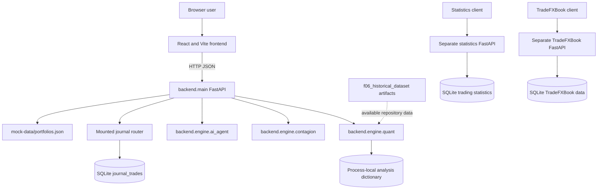

# Architecture

## Scope

The primary F-06 system is the React/Vite frontend and the FastAPI application in `backend/main.py`. The trading journal is mounted inside that FastAPI process. The trading-statistics service and TradeFXBook are separate applications with separate databases and startup commands.

## Runtime architecture

The dashed dataset edge is intentionally marked as available repository data, not as a verified runtime dependency: `compute_stochastic_cone_and_history` currently constructs its displayed historical observations from fixed month and multiplier arrays.

## F-06 request flow

1. The frontend calls `GET /api/portfolios` and can also use local portfolio definitions in `frontend/src/pages/website/portfolioData.ts`.
2. The frontend posts validated portfolio and scenario data to `POST /api/analyze-scenario`.
3. Pydantic models reject unknown fields on the main F-06 request and enforce numeric bounds.
4. A non-empty prompt is passed to the deterministic `parse_custom_scenario` parser. Parsed values override matching slider values.
5. `run_portfolio_scenario` applies factor shocks, computes risk metrics, correlations, projection data, and a fixed defensive alternative.
6. `generate_ai_insights` creates rule-based assumptions and conflict messages. It does not call an external model provider.
7. `main.py` normalizes engine output, adds a disclaimer, saves a copy in an in-memory dictionary, and returns JSON.

## Components and storage

- `backend/main.py`: application construction, CORS, request models, route handlers, output normalization, and startup.
- `backend/engine/quant.py`: composition, HHI-style diversification score, correlation lookup/inference, stress calculation, stochastic display cone, alternative allocation, CVaR, pain, ulcer, reverse stress, and tail dependence helpers.
- `backend/engine/ai_agent.py`: keyword parser, financial-trilemma rule, horizon/liquidity/risk/correlation conflicts, and assumptions.
- `backend/engine/contagion.py`: dependency graph, bounded multi-hop propagation, portfolio impact, and hedge suggestion.
- `backend/database.py`: process-local analysis records protected by a re-entrant lock; no migration or durable F-06 history exists.
- `backend/journal/storage.py`: SQLite `journal_trades` table with indexes on user/closed date and user/symbol; WAL mode is enabled.

## Trust boundaries and failure paths

The browser trusts the configured API origin. CORS defaults to local frontend origins, is controlled by `CORS_ORIGINS`, and does not authenticate users. The journal identity dependency always returns `demo`. Invalid request models produce FastAPI validation errors; missing portfolio data produces 500; unavailable engines produce 503; malformed engine output produces 502; contagion and reverse-stress execution exceptions are returned as 500.

No Dockerfile, CI workflow, deployment manifest, monitoring, or production identity provider was found. The statistics and TradeFXBook applications are not automatically started by the F-06 frontend.
